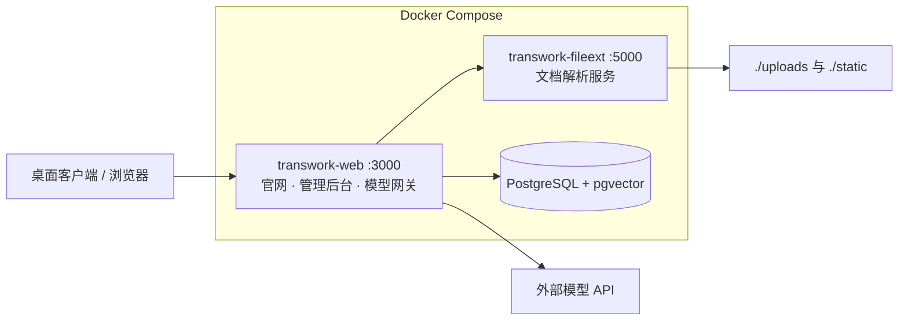

# TransWork

企业级桌面 AI Agent 工作台 —— 让技能（Skills）、知识库与数字员工（Digital Employees）在同一处协作。

Enterprise desktop AI Agent workspace. Self-host the full platform with one command, free for up to 5 seats.

官网：https://transwork.tree456.com/

## 为什么选择 TransWork

- **一键私有部署**：Docker Compose 拉起全部服务，数据 100% 留在自己服务器
- **免费 5 席位**：内置免费授权，5 个席位、无到期时间、无功能阉割，团队小规模使用零成本
- **企业级管控**：用户/角色/资源授权、登录安全策略、审计日志开箱即用
- **模型统一网关**：集中配置模型密钥，按用户/日期/模型统计用量，密钥不下发到终端

## 核心特性

| 能力 | 说明 |
| --- | --- |
| 技能市场（Skill Hub） | 技能包上传、分类管理、版本化分发，客户端一键获取 |
| 数字员工（Agent Hub） | 数字员工配置分发，按角色授予团队可用范围 |
| 知识库 | 文档解析 + pgvector 向量检索，支持后台解析任务与恶意文件扫描开关 |
| 模型网关 | 统一接入各家模型，主密钥 AES-GCM 加密存储，用量按用户/模型预聚合 |
| 单点登录 | 钉钉、企业微信、飞书、通用 OIDC、LDAP/AD，密钥仅存服务端 |
| 组织与权限 | 用户、角色、资源授权（按角色并集下发 Skill 与数字员工） |
| 安全策略 | 会话有效期、每日重新认证、登录失败锁定，服务端强制执行并记审计 |
| 品牌白标 | 自定义产品名称与 Logo，打造你自己的企业 AI 门户 |

## 免费授权说明

- 部署即自带**内置免费授权：5 个席位，无到期时间**，无需注册或导入授权码。
- 席位在用户首次登录时分配，同一用户重复登录不重复占用；5 席用满后新用户登录会被拒绝。
- 团队扩大后购买 License 并在「管理后台 → 组织配置 → 授权配置」导入授权码即可扩容；升级到不少于 5 席位的 License 时，现有席位自动迁移，已登录用户无需重新登录。
- 商业授权与更大规模私有化部署请通过 [官网](https://transwork.tree456.com/) 或 [GitHub Issues](https://github.com/shuyu-labs/taranswork/issues) 联系我们。

## 快速开始

> 推荐 Linux x86_64 服务器（Windows / macOS 可使用 WSL2 或任意云主机体验）。
> 以下命令在仓库根目录执行。

```bash
git clone git@github.com:shuyu-labs/taranswork.git
cd taranswork
docker compose up -d
```

首次启动会自动完成 pgvector 扩展初始化、数据库建表与演示数据导入，等待约 1 分钟后访问：

| 入口 | 地址 | 默认账号 |
| --- | --- | --- |
| 产品官网 | http://localhost:3000/ | - |
| 管理后台 | http://localhost:3000/admin | `admin` / `TransWork_Admin_2026` |
| 技能市场 | http://localhost:3000/skill-hub | - |
| 数字员工 | http://localhost:3000/agent-hub | - |
| 文档解析服务 | http://localhost:5002 | - |

登录后台后，在「模型与系统」中配置你的模型接入，即可开始使用。

## 架构



- 业务数据保存在命名卷 `transwork-postgres-data`，网站文件资产（Skill 包、Logo、机器码等）保存在命名卷 `transwork-data`。
- 容器会挂载宿主机 `/etc/machine-id` 与 `/sys/class/dmi/id/product_uuid` 生成稳定的系统识别码，授权码绑定该识别码。
- 所有镜像托管在阿里云容器镜像服务（ACR），国内服务器拉取速度快。

## 配置项

仓库自带的 `.env` 即为演示配置，开箱即用；公网部署请至少修改下表中标星项。

| 变量 | 说明 | 默认值 |
| --- | --- | --- |
| `PATH2AI_HTTP_PORT` ★ | 对外 HTTP 端口 | `3000` |
| `PATH2AI_PUBLIC_BASE_URL` ★ | 对外访问的根地址，SSO 回调基于它 | `http://localhost:3000` |
| `PATH2AI_ADMIN_USERNAME` | 管理后台账号 | `admin` |
| `PATH2AI_ADMIN_PASSWORD` ★ | 管理后台密码，请改为至少 16 位强密码 | `TransWork_Admin_2026` |
| `POSTGRES_*` ★ | 数据库库名/账号/密码，改密码后需同步修改两个连接串 | 见 `.env` |
| `PATH2AI_POSTGRES_CONNECTION_STRING` ★ | 业务连接串，密码含 `@`、`:`、`/` 时需 URL 编码 | 见 `.env` |
| `PATH2AI_MODEL_GATEWAY_MASTER_KEY` ★ | 模型网关主密钥，至少 32 位随机字符串，同时用于 SSO 密钥加密 | 见 `.env` |
| `FILEEXT_HTTP_PORT` | 文档解析服务对外端口 | `5002` |
| `FILE_EXTRACTION_BASE_URL` | Web 容器访问解析服务的内网地址，保持 `http://fileext:5000` | `http://fileext:5000` |
| `FILE_EXTRACTION_SERVICE_TOKEN` | 解析服务 Bearer Token（未启用则留空） | 空 |
| `FILE_EXTRACTION_TIMEOUT_MS` | 解析超时时间 | `120000` |

## 桌面客户端

**网盘下载（夸克）**：https://pan.quark.cn/s/4b30591299e1 ，提取码：`8kb8`

也可在官网获取：https://transwork.tree456.com/

客户端连接你部署的服务端后，即可使用技能市场、数字员工与知识库；SSO 登录方式会在客户端登录页自动发现，无需把平台密钥写入客户端。

## 生产部署安全清单

演示配置中的默认密码已随仓库公开，**公网部署前必须逐项确认**：

1. 修改 `PATH2AI_ADMIN_PASSWORD`（至少 16 位强密码）。
2. 修改数据库密码，并同步更新 `PATH2AI_POSTGRES_CONNECTION_STRING` 与 `PATH2AI_POSTGRES_ADMIN_CONNECTION_STRING`。
3. 重新生成 `PATH2AI_MODEL_GATEWAY_MASTER_KEY`（至少 32 位随机字符串）。
4. 配置 HTTPS 域名并设置 `PATH2AI_PUBLIC_BASE_URL`（根地址，不带路径），使用反向代理终止 TLS。
5. 文档解析服务端口 `5002` 仅限内网访问，不要暴露到公网。
6. 不要执行 `docker compose down -v`，除非确认要删除全部业务数据。

## 常用命令

```bash
docker compose up -d          # 启动
docker compose ps             # 查看状态
docker compose logs -f transwork-web   # 网站日志
docker compose logs pgvector-init      # 数据库初始化日志
docker compose down           # 停止（保留数据）
docker compose pull && docker compose up -d   # 升级到最新镜像
```

数据备份：业务数据在卷 `transwork-postgres-data`，文件资产在卷 `transwork-data`，升级前建议先备份。

## 交流与支持

欢迎扫码加入微信交流群，或添加作者微信反馈问题、交流使用心得：

| 交流群 | 作者微信 |
| --- | --- |
|  |  |

- 问题反馈与功能建议：[GitHub Issues](https://github.com/shuyu-labs/taranswork/issues)
- 商业授权、私有化部署咨询：[官网](https://transwork.tree456.com/)
